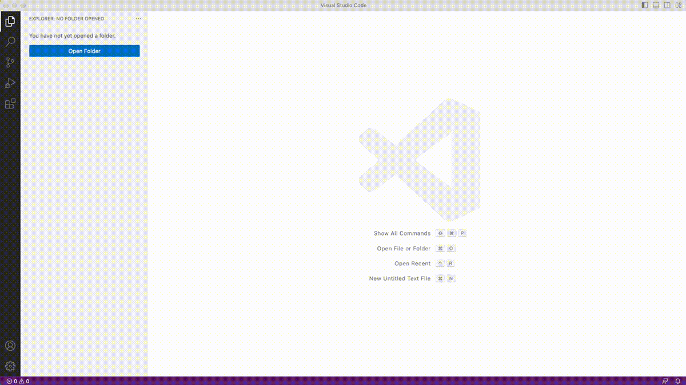
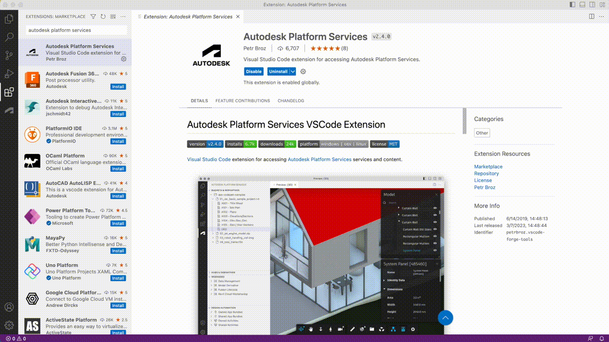
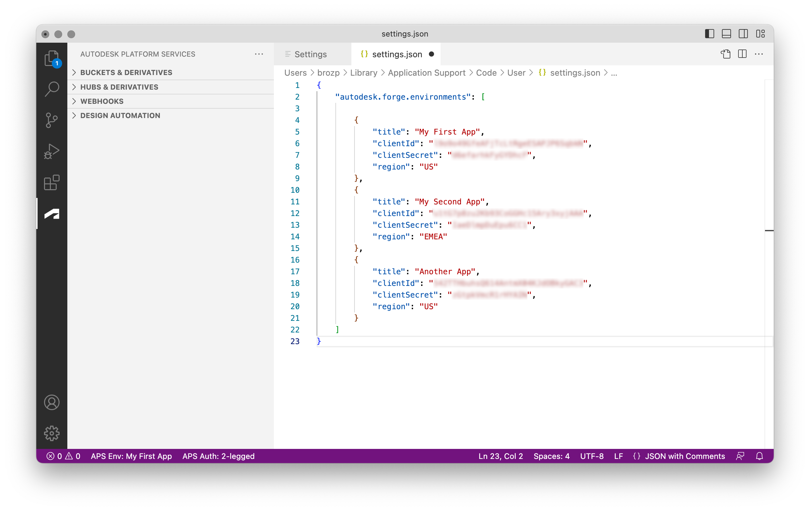
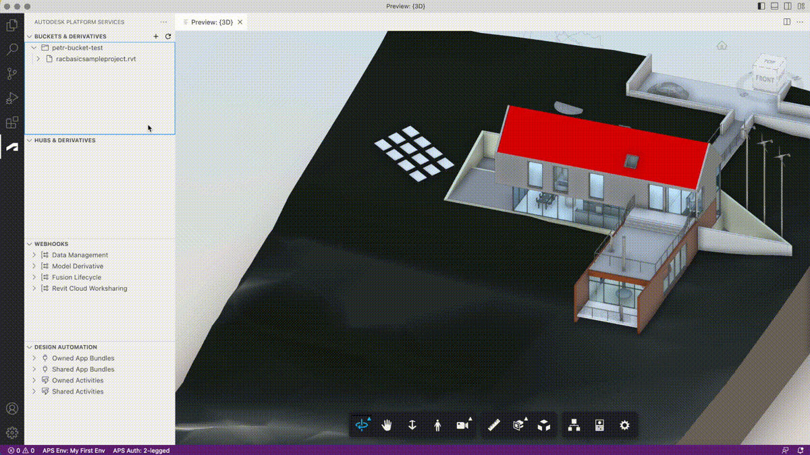
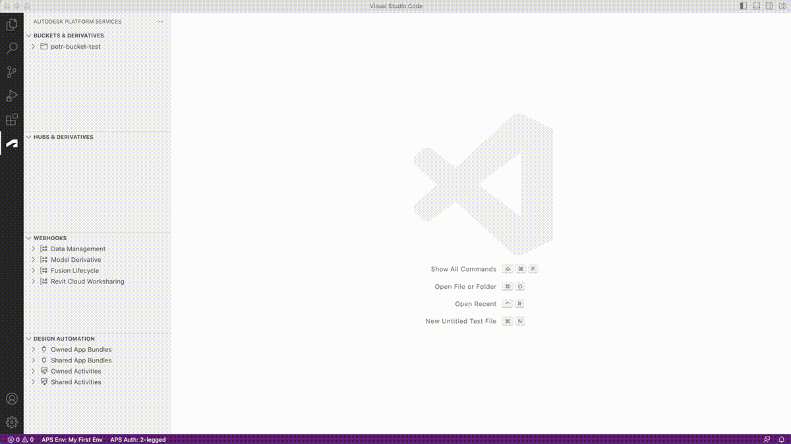
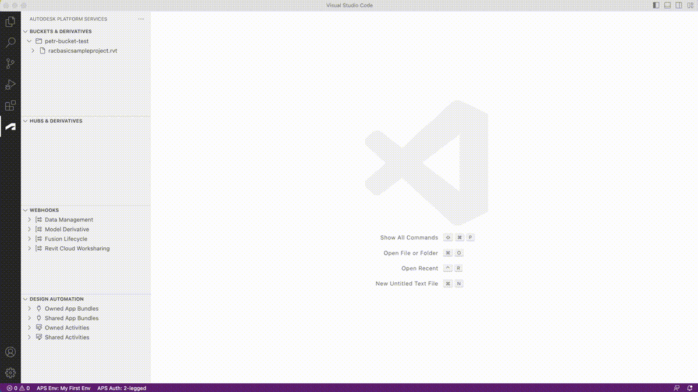
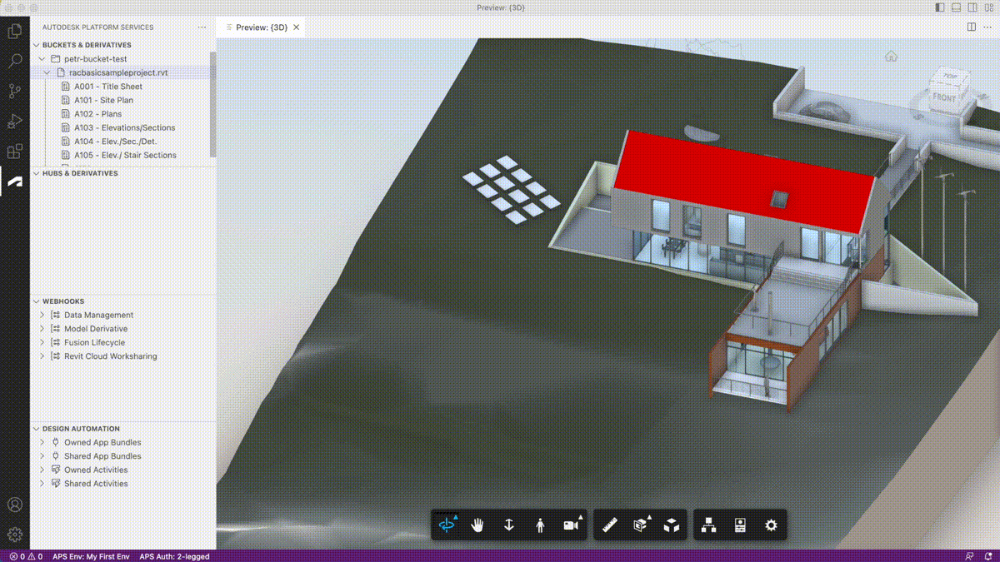

# Autodesk Platform Services (VS Code extension)

[Visual Studio Code](https://code.visualstudio.com) extension for accessing [Autodesk Platform Services](https://aps.autodesk.com) (APS) services and content.

> Note: [Autodesk Forge is now Autodesk Platform Services](https://aps.autodesk.com/blog/autodesk-forge-becoming-autodesk-platform-services), but you may still see the _Forge_ brand in a few places: the `autodesk.forge.*` settings, the extension ID (`petrbroz.vscode-forge-tools`), and the callback URL described below. These have been kept to maintain backwards compatibility.

## Requirements

- [Visual Studio Code](https://code.visualstudio.com) version 1.95.0 or newer (or a compatible editor such as [Cursor](https://cursor.com))
- APS app credentials ([tutorial](https://aps.autodesk.com/en/docs/oauth/v2/tutorials/create-app))
- **If you plan to sign in with 3-legged OAuth** (see [Authentication](#authentication)), your APS app
  must have `vscode://petrbroz.vscode-forge-tools/callback` registered as a callback URL on
  [https://aps.autodesk.com/myapps](https://aps.autodesk.com/myapps), or sign-in will fail with
  a redirect URI mismatch. The `vscode://` scheme is specific to Visual Studio Code itself. Other
  VS Code-based editors register their own URI scheme, so the callback URL to register there uses that
  editor's scheme instead, for example `cursor://petrbroz.vscode-forge-tools/callback` in
  [Cursor](https://cursor.com), or `antigravity-ide://petrbroz.vscode-forge-tools/callback` in
  [Antigravity](https://antigravity.google). The extension always shows you the exact URL to register the
  first time you sign in (see [Authentication](#authentication)).

## Installation

The extension is published on the [Visual Studio Marketplace](https://marketplace.visualstudio.com/items?itemName=petrbroz.vscode-forge-tools) and on [Open VSX](https://open-vsx.org/extension/petrbroz/vscode-forge-tools) (used by editors such as VSCodium, Cursor, and Windsurf).

While in Visual Studio Code:

1. Switch to the _Extensions_ sidebar (`Cmd`+`Shift`+`X` on macOS or `Ctrl`+`Shift`+`X` on Windows), search for the _Autodesk Platform Services_ extension, and install it.

2. When you activate the _Autodesk Platform Services_ extension for the first time, it guides you through creating your first "environment". An environment is a configuration for a specific APS application, including its client ID and secret, or region, for example.

> You can configure additional environments or update existing ones by going to _User Settings_ (`Cmd`+`,` on macOS or `Ctrl`+`,` on Windows), searching for _autodesk environments_, clicking the _Edit in settings.json_ link, and modifying the JSON settings manually. Switch to the _User_ or _Workspace_ tab depending on whether you want to persist the settings globally (for all instances of the editor) or locally (only for a specific workspace). Changes made directly in `settings.json` are applied without reloading the window.

## Extension settings

The extension exposes the following settings:

- `autodesk.forge.environments`: array of objects representing different APS applications or "environments". Each environment can specify the following properties:
  - `title` (required): unique name of the environment (shown in the status bar and listed when switching between environments)
  - `clientId` (required): APS client ID
  - `clientSecret` (required): APS client secret
  - `host`: APS host URL (default `https://developer.api.autodesk.com`)
  - `region`: data region for storing design data; can be `US` (default), `EMEA`, `AUS`, `CAN`, `DEU`, `IND`, `JPN`, or `GBR`
  - `designAutomationRegion`: Design Automation region; can be `us-east` (default) or `us-west`
- `autodesk.forge.data.defaultContentType`: content type to use for all files and empty objects uploaded to OSS (default `application/octet-stream`)
- `autodesk.forge.data.uploadChunkSize`: size of individual chunks (in bytes) when uploading files to OSS with the resumable functionality (default `2097152`)
- `autodesk.forge.data.pageSize`: number of buckets or objects to fetch per page in the _Data & Derivatives (app)_ view before showing a "Load more" item (default `32`)
- `autodesk.forge.data.hubsPageSize`: number of projects, folder items, or versions to fetch per page in the _Data & Derivatives (user)_ view before showing a "Load more" item (default `32`)
- `autodesk.forge.enableTeamAdminApi`: enable the _Team Admin (user)_ view for the Team Admin API (Beta). When enabled, signing in with 3-legged OAuth requests additional scopes (`tmadmapi:*`), so your APS app must have the Team Admin API enabled. Sign in again after changing this setting.
- `autodesk.forge.viewer.extensions`: array of Viewer [extension](https://aps.autodesk.com/en/docs/viewer/v7/reference/Extensions) IDs (for example, `Autodesk.VisualClusters` or `Autodesk.DocumentBrowser`) to load automatically when previewing derivatives
- `autodesk.forge.viewer.api`: Model Derivative API used by the viewer; by default, the viewer determines the appropriate API based on the viewable output format (SVF vs SVF2)
- `autodesk.forge.viewer.env`: Model Derivative environment used by the viewer; by default, the viewer determines the appropriate environment based on the viewable output format (SVF vs SVF2)

Here's an example of what the extension settings might look like in JSON format:

## Features

### Multiple environments

If you have configured multiple APS environments, you can switch between them via the status bar at the bottom, or using the `aps.switchEnvironment` command from the [Command Palette](https://code.visualstudio.com/docs/getstarted/userinterface#_command-palette). The extension always initializes itself based on the _first_ environment in the list.

> Note: if you have configured the extension both in the _User_ scope and in the _Workspace_ scope, the extension presents the list of environments from the _Workspace_ scope as it has higher precedence.

### Authentication

Plain 2-legged (app) access is always available by default, and backs every "(app)" view below. Views and commands that need a user context (_Data & Derivatives (user)_, _Issues (user)_, _Webhooks (user)_, _Hub Admin (user)_, and _Team Admin (user)_) show a "Sign in to APS" welcome button until you're signed in. You can also sign in via the `aps.auth.login` command or the VS Code Accounts menu. Signing in offers a choice of 3-legged OAuth (confidential client), 3-legged OAuth with PKCE (public client, no secret), a Secure Service Account (sign in on behalf of a service account using its private key), or pasting an access token obtained from another APS application. Sessions are persisted per environment in VS Code's encrypted secret storage, so they survive a window reload, and 3-legged/PKCE tokens are refreshed automatically. Once signed in, use the "Logout" action in the title bar of any user-context view (or the `aps.auth.logout` command) to sign out again.

> **Important:** the 3-legged OAuth flows ("3-legged OAuth" and "3-legged OAuth with PKCE") redirect back into the editor via a `<uriScheme>://petrbroz.vscode-forge-tools/callback` URI (resolved through `vscode.env.asExternalUri`, so it also works in remote/SSH, Codespaces, and vscode.dev). `<uriScheme>` is `vscode` in Visual Studio Code, but other VS Code-based editors register their own scheme instead, for example `cursor` in [Cursor](https://cursor.com) or `antigravity-ide` in [Antigravity](https://antigravity.google), so the callback URL to register depends on which editor you're running the extension in. **You must register this URL (or, when working in a remote/web context, whatever URL `vscode.env.asExternalUri` resolves it to) as a callback URL for your application on [https://aps.autodesk.com/myapps](https://aps.autodesk.com/myapps), or sign-in will fail.** The extension also shows you this URL, with a "Copy URL" action, the first time you use one of these sign-in methods.

To get an access token for use in other tools, run the `Generate Access Token` command (`aps.auth.getAccessToken`).

### Data & Derivatives (app) view

The _Data & Derivatives (app)_ view allows you to browse [Data Management](https://aps.autodesk.com/en/docs/data/v2/developers_guide/overview) OSS (Object Storage Service) content, create buckets, upload and download files (including drag and drop from your OS onto a bucket), translate them using the [Model Derivative](https://aps.autodesk.com/en/docs/model-derivative/v2) service, and preview the generated derivatives in a custom editor tab. All derivatives are listed as children of their corresponding objects in the tree. If there are no derivatives yet, or if there's been an issue with the translation, the tree view provides additional information. Large buckets are paged; use the "Load more" item at the end of a list to fetch more entries.

Here are some actions you can try:

1. Create a new bucket to store your designs.

> Note that bucket names must be globally unique. If you see a `409 Conflict` error, you'll need to choose a different name.

2. Upload a design to your bucket.

3. Translate the design for viewing.

4. Preview design derivatives in a new editor tab.

5. Copy the object's URN (for use with other APIs and tools) from its context menu.

Other actions available from the context menu include creating empty objects, copying, renaming, and deleting objects, generating signed URLs, and viewing derivative manifests, thumbnails, trees, and properties.

### Data & Derivatives (user) view

Similar to the _Data & Derivatives (app)_ view, but using a signed-in user context instead, allowing you to browse your existing design data hosted in BIM 360, ACC, and other products built with Autodesk Platform Services. See [Authentication](#authentication) above for how to sign in.

### Issues (user) view

The _Issues (user)_ view lets you browse [ACC/BIM 360 issues](https://aps.autodesk.com/en/docs/issues/v2/developers_guide/overview/) in a hub → project → issue tree, and open a details panel for an individual issue that also lists its comments, if any. Requires the same signed-in user context as the other "(user)" views.

### Webhooks (app) and Webhooks (user) views

The _Webhooks (app)_ and _Webhooks (user)_ views can be used to browse and manage app-owned and user-owned webhooks, respectively, in the [Webhooks](https://aps.autodesk.com/en/docs/webhooks/v1/developers_guide/overview) service, across all supported webhook systems (Data Management, Model Derivative, Cost Management, Forma Issues, Forma Reviews, Autodesk Tandem, and more). Inactive webhooks are marked with a badge.

### Automation (app) view

The _Automation (app)_ view can be used for browsing [Design Automation](https://aps.autodesk.com/en/docs/design-automation/v3/developers_guide/overview) entities such as app bundles and activities, creating and updating them (including their aliases and versions), and submitting work items against an activity. Work item progress is shown in a notification that can be cancelled. The view also provides a context menu for viewing additional details of individual bundles or activities. The Design Automation region is configured per environment (see `designAutomationRegion` in [Extension settings](#extension-settings)).

### Secure Service Accounts (app) view

Manage your [Secure Service Accounts](https://aps.autodesk.com/en/docs/ssa/v1/developers_guide/overview/) and their keys through the _Secure Service Accounts (app)_ view and the context menu of individual tree items, including generating assertions and access tokens for a key. You can also use any commands starting with `Secure Service Accounts:`.

### Hub Admin (app) and Hub Admin (user) views

The _Hub Admin (app)_ and _Hub Admin (user)_ views provide read-only browsing of ACC account administration data, using the [Account Admin API](https://aps.autodesk.com/en/docs/acc/v1/overview/field-guide/admin/), in a hub → users, projects, and companies tree. Project nodes list their project users, and context menus let you view details and copy IDs. The _app_ variant uses 2-legged access, and the _user_ variant uses the signed-in user context.

### Team Admin (user) view

The _Team Admin (user)_ view uses the [Team Admin API](https://aps.autodesk.com/en/docs/team_admin/v1/developers_guide/overview/) (Beta) to browse the teams you administer in a team → users/product pools → assignments tree, invite users to a team, and assign or unassign products. The API only accepts 3-legged tokens of a team administrator, and your APS app must have the Team Admin API enabled. Turn on the `autodesk.forge.enableTeamAdminApi` setting, then sign in again with 3-legged OAuth (with or without PKCE). Enabling it makes sign-in request the additional `tmadmapi:*` scopes the API needs. The API runs in production, so changes affect real teams and seats.

### Language model tools

The extension contributes [language model tools](https://code.visualstudio.com/api/extension-guides/tools) that let the chat in agent mode operate on APS resources of the current environment:

| Tool | Reference | What it does |
|---|---|---|
| `aps_listBuckets` | `#apsListBuckets` | List OSS buckets |
| `aps_createBucket` | `#apsCreateBucket` | Create an OSS bucket |
| `aps_listObjects` | `#apsListObjects` | List objects in a bucket |
| `aps_uploadFile` | `#apsUploadFile` | Upload a file to a bucket |
| `aps_translateObject` | `#apsTranslateObject` | Start an SVF2 translation |
| `aps_getTranslationStatus` | `#apsTranslationStatus` | Check the status of a translation |
| `aps_listWebhookEvents` | `#apsListWebhookEvents` | List webhook events |
| `aps_createWebhook` | `#apsCreateWebhook` | Create a webhook |

Tools that create or modify resources ask for confirmation before running. You can also reference the tools in your chat prompts explicitly, for example, `#apsCreateBucket` or `#apsUploadFile`.

### Localization

The extension UI is available in English and Japanese, and follows the display language of your editor. There is no separate language setting. To switch:

1. Open the Command Palette and run _Configure Display Language_.
2. Select _日本語_ (Japanese) or _English_. If Japanese isn't listed, install the [Japanese Language Pack for Visual Studio Code](https://marketplace.visualstudio.com/items?itemName=MS-CEINTL.vscode-language-pack-ja) first.
3. Restart VS Code when prompted.

Note that this changes the display language of the whole editor, not only this extension.

## Known limitations and issues

### Derivatives in custom regions, and status code 406

The Model Derivative service lets you store derivatives in a region of your choice. The extension always assumes that the derivatives are stored in the same region as the input object. This can cause issues, for example, when you use the `Translate Object` or `Translate Object (Custom)` command on an object for which the derivatives are already available in another region. In that case you get an error with status code 406, and you need to delete the derivatives manually (using the `Delete Derivatives` command) before being able to translate the object again.

## Development

- Clone the repository: `git clone https://github.com/autodesk-platform-services/aps-vscode-extension.git`
- Install dependencies: `yarn install`
- Open the project in VS Code and launch the _Launch Extension_ task. A new VS Code window opens.
- Make sure you have at least one set of APS credentials configured (see [Installation](#installation) and [Extension settings](#extension-settings)).
- Click the APS icon in the sidebar and start browsing.

Useful scripts:

- `yarn build`: development build (extension and webviews) into `out/`
- `yarn typecheck`: type-check the project with `tsc --noEmit`
- `yarn test`: run the test suite

> When debugging a webview inside VS Code, use the `Developer: Open Webview Developer Tools` and the `Developer: Reload Window` commands.

The repository follows a strict layering (`models` ← `services` ← `commands`/`providers`/`tools`, with `webviews` depending only on `models`). See [CLAUDE.md](./CLAUDE.md) for details before contributing code. CI (typecheck, build, tests) runs on pushes and pull requests to `develop`, and pushing a version tag (`v*`) publishes the extension to both the Visual Studio Marketplace and Open VSX.

## Contributing and feedback

Bug reports and feature requests are welcome on the [issue tracker](https://github.com/autodesk-platform-services/aps-vscode-extension/issues). Pull requests should target the `develop` branch. For questions about the APS services themselves, see the [APS documentation](https://aps.autodesk.com/en/docs/) or [Stack Overflow](https://stackoverflow.com/questions/tagged/autodesk-forge).

## Troubleshooting

### Cannot preview re-translated designs

VS Code caches some of the HTTP requests made by the viewer. When you preview a design that's been re-translated, the viewer may get a cached manifest JSON that's outdated. The only known workaround is to clear the VS Code cache: https://theblogreaders.com/visual-studio-code-tip-cleanup-cache-folder-better-performance.

## License

[MIT](./LICENSE)
